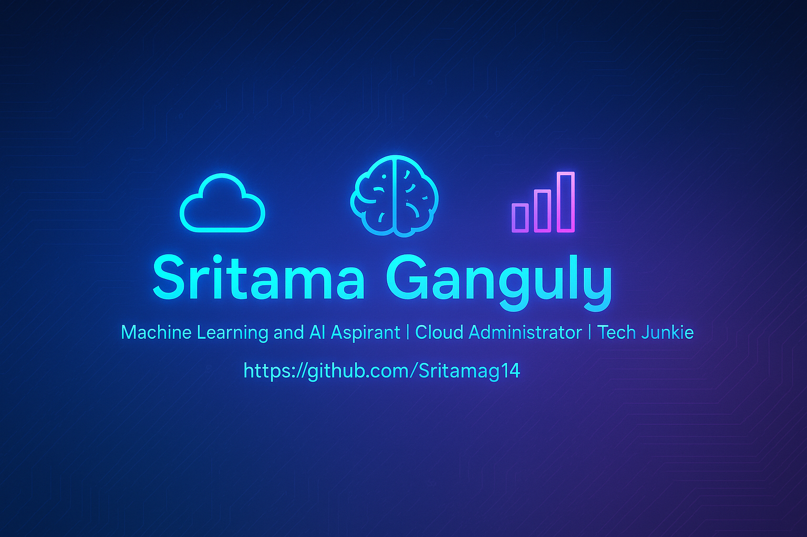

  

# 👋 Hi, I'm Sritama Ganguly!

🎯 **Machine Learning and AI Aspirant**  
☁️ **Cloud Administrator | Microsoft 365 | Exchange**  
🧠 **Tech Junkie | Lifelong Learner**  

---

## 💻 About Me

I'm currently working as a **Cloud & Exchange Administrator at Accenture**, but my journey into tech wasn't a conventional one. With a background in **Humanities and Mass Communication**, my passion led me to self-learn cloud technologies and now I'm advancing through the **Professional Certificate Course in Gen AI and Machine Learning with IIT Kanpur & Simplilearn**.

---

## 🧰 Tech Stack

- 🌐 Learning: `Python`, `Machine Learning`, `Generative AI`  
- 🗄️ Basics of: `SQL`  
- ☁️ Experience with: `Microsoft 365`, `Exchange`, `Cloud Concepts`

---

## 📂 Featured Projects

Here are some highlights from my hands‑on work:

 – A personal finance management tool  

 – Data exploration and insights from sales records  

 – Predicting employee attrition using ML (feature analysis, SMOTE, k‑fold validation & retention strategy)

---

## 📁 Project Repositories

These are the main repositories where I build and refine my coding projects:

- [🔹 Python Foundation Projects](https://github.com/Sritamag14/Python-Foundation-Projects) – A collection of exercises and mini‑projects to strengthen my core Python programming skills.  
- [🔹 Machine Learning Projects](https://github.com/Sritamag14/Machine-Learning-Projects) – My main ML workspace containing full‑scale projects.

---

## 💡 Fun Fact

Despite coming from a completely non‑technical academic background, I leaped into tech purely out of passion and curiosity — and I'm just getting started!

---

## 📫 Connect With Me

---

## 🌟 GitHub Stats & Badges

  

---

_Thanks for visiting my profile! Stay curious and keep building 🚀_
